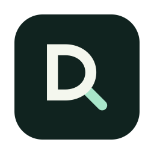

<p align="center"></p>

<h1 align="center">Redig</h1>

> **Redig — independent fork by [100xA](https://github.com/100xA).**
> DigUp was created by **[Abdur Rahim (ARahim3)](https://github.com/ARahim3/DigUp)**. The original app, search
> engine, interface and documentation are his work, shared under the [MIT license](LICENSE). This fork adds
> performance improvements, consistency fixes, a local Mac file organizer and a new minimal icon. Upstream copyright
> and dependency notices are preserved. See [the efficiency changes](docs/EFFICIENCY.md) and
> [the Mac organizer](docs/ORGANIZER.md).

<p align="center"><b>Describe it. Dig it up.</b><br>
Search the files on your computer by what's in them, with Google DeepMind's
<a href="https://huggingface.co/google/embeddinggemma-2">EmbeddingGemma 2</a>.</p>

<p align="center"><a href="#build-from-source"><b>Build this fork</b></a> ·
<a href="https://github.com/ARahim3/DigUp"><b>Original project</b></a><br>
<sub>Free and open source. Everything runs on your computer.</sub></p>

<p align="center"></p>

EmbeddingGemma 2 is the multimodal embedding model Google DeepMind released in October 2026. It puts text, images,
audio and video into one shared space: a photo of a dog on a beach lands next to the words "a dog on the beach", and a
recording of someone talking about sleep lands next to "where they talk about sleep". It understands more than 100
languages, it's open (Apache 2.0), and at 740M parameters it's small enough to run on a laptop.

Redig brings that to the files on your computer, on a Mac, on Windows or on Linux. Pick the folders to search, and it
reads the pictures, PDFs, documents, recordings and videos in them. Then describe what you're looking for, in your own
words, and it finds the match, whatever kind of file it is.

## What you can find

- "zebra in a video" opens the clip at the moment the zebra shows up
- "where they talk about sleep" jumps to that minute of a podcast
- "the clause about pets in the lease" shows the PDF page
- "a dog on the beach" finds the photo, and "payment declined error" the screenshot
- a search in English can find a note written in Bengali, Arabic or any of the model's 100+ languages, and the other
  way around
- "code: retry a failed call with backoff" finds the function in your projects, if you turn on code search

Exact words count too. Invoice numbers, error codes and names are matched as written, in file names and document text,
so a search gets both the meaning and the exact string. On a Mac that includes the text inside screenshots.

## Private

Nothing you index leaves your computer. Redig goes online to download the model once. Upstream release builds also
check for updates once a day; these checks are disabled in this source fork. No account, no telemetry.

## Local organizer for Mac

Press **⇧⌘Space**, type **`>auto on`** and press Return to start watching Downloads. Or open **Settings → Organizer**
and choose **Organize Downloads Automatically**. Drop related files into Downloads; once indexed and settled, clear
groups of at least two related files can create their own folders under **Redig Organized**. Existing project folders
can receive matching new files too. No project-folder setup is needed.

Type **`>`** in either search bar for commands, completions and inline projects, review and history. **`>preview`**
refreshes groups without filing, **`>sort`** files ready strong matches once, **`>projects`** browses collections, and
**`>undo`** restores the latest undoable move. Arrow keys choose commands, Tab completes, Return runs, and Escape
returns to file search. Typing a command performs no action. See [the full command list](docs/ORGANIZER.md#search-bar-commands).

Use **Settings → Organizer** to include Desktop, Documents or other folders, rename collections, or disable new folder
creation. Uncertain and individual unmatched files stay for review. Each move is recorded on disk; **Undo** restores an
unchanged file when its original location is free, including after restarting the app. Returned files are excluded from
automatic refiling.

Folder setup and automatic filing are off on a fresh installation. This first version organizes the file types Redig
can index; it does not rearrange code repositories, apps, archives or cloud-only placeholders. Everything runs locally
after the existing model download. See [setup, behavior and recovery details](docs/ORGANIZER.md).

## Install

This fork is currently distributed as source. Build it using the instructions below. The official upstream packages
listed here are Abdur Rahim's releases and do not include this fork's changes. Automatic upstream updates are
disabled in fork builds so they cannot replace the fork; a maintainer must configure a separate signed feed before
enabling updates.

Redig currently ships as source for Apple Silicon Macs running macOS 14 or later. Build it below and open
`Redig.app`. Windows and Linux packaging scripts also use the Redig name; the upstream DigUp packages do not contain
this fork's organizer or other changes.

On first launch, choose folders to search and download the local model if it is missing. Press **⇧⌘Space** to search
from any app. Use **Settings → Organizer** to start project grouping for Downloads, Desktop and Documents.

## Using it

| Mac | Windows and Linux | What it does |
|---|---|---|
| ⇧⌘Space | Ctrl+Shift+Space | Opens the search panel from any app (you can change it) |
| ↓ ↑ | ↓ ↑ | Moves through the results |
| ↩ | Enter | Opens the result: PDFs at the page, recordings and videos at the moment, code in your editor at the line |
| Space | Space | A big preview, at the page or moment (once you've moved to a result) |
| ⌘↩ | Ctrl+Enter | Shows it in Finder, Explorer or your file manager |
| ⌘C | Ctrl+C (in the window) | Copies the file, to paste anywhere |
| ⌘O | Ctrl+O | The same search in a bigger window, with a picture grid and filters |

Redig lives in the menu bar on a Mac and in the tray on Windows and Linux, where you can see how indexing is going,
pause it, or open Settings. Opening it from the Start menu or your app list shows the search window.

A few things differ by system:

- On a Mac, a video opens at its moment in QuickTime Player (macOS asks once whether Redig may control it) or IINA,
  and a PDF opens in Preview with your words in its search. On Windows and Linux, PDFs open at the page in your PDF
  viewer if it's one that can be told a page (Edge, Chrome, Firefox, Acrobat, SumatraPDF, Evince, Okular), and
  recordings and videos at the moment in VLC, mpv or MPC-HC. Other apps open the file from the start; the big
  preview plays it from the moment either way.
- On GNOME and KDE under Wayland, which don't let apps set their own shortcuts, Redig adds Ctrl+Shift+Space to the
  desktop's keyboard settings during setup, and you change it there. On other Wayland desktops, Settings shows the
  command to give a shortcut of your own.
- On GNOME, the tray icon needs the AppIndicator extension, which Ubuntu includes. Without it, the window's ⋯ menu has
  the same items.

## What it reads

Only the folders you choose:

- pictures and screenshots (JPEG, PNG, HEIC, WebP and more), by what they show, and on a Mac screenshots by their text
  too
- PDFs, page by page, scans included. A long one gets its first 30 pages right away and the rest once everything
  else is in (up to 5,000 pages a file)
- documents: txt, md, rtf, docx, odt, html, and on a Mac doc, long ones the same way. Text that's mostly numbers,
  like a data export, is matched by its exact text only
- audio of any length: the model listens to 30 seconds at a time, so Redig takes overlapping 30-second windows and a
  match points to its moment
- video of any length: a frame every few seconds, one per shot, plus the soundtrack the same way as audio

Outside the folders you pick for code search, it never reads code, and inside a code project (a folder with `.git`,
`package.json` and the like) it reads only screenshots. It never reads keys, certificates, password files, hidden
folders like `.ssh`, apps or caches. It skips folders that look like datasets, and never downloads files that only
live in the cloud (iCloud on a Mac, OneDrive on Windows). You can skip more folders or file types in Settings. Redig
searches your files without modifying their contents or uploading them. On Mac, the optional organizer can move files
under the folders you enable, with a persistent undo history.

The first pass happens once. On a Mac it takes a few minutes for a few hundred files and can take an hour for a big
Downloads folder. On Windows and Linux, Redig runs the model on the graphics card where that's faster and on the
processor otherwise; on a processor alone a picture takes a few seconds (about five on a 2017 laptop's Core i5), so a
large photo library can take hours, which is why setup shows the time first. After that, a new file is searchable a
few seconds after it lands.

## Code

EmbeddingGemma 2 reads code too, so Redig can search your projects. Code search is off until you turn it on, in
Settings → Code or during setup, for the folders you pick. Each repo shows how long reading it takes and how much room
its index needs. Then start a search with `code:` and say what the code does, or type a name that's in it:

- "code: retry a failed call with backoff" finds the function, whatever it's called
- "code: refreshAccessToken" goes to the line that defines it, not the places that call it
- "code: plot how many examples each class has" finds the notebook cell

Results open in your editor at the line: Zed, VS Code, Cursor, Sublime Text, JetBrains IDEs and a few more, Xcode on
a Mac and Notepad++ on Windows (pick one in Settings). Code has an index of its own and never shows up in other
searches. Redig reads source files, notebooks (without their outputs) and a repo's own docs. It skips what git
ignores, vendored and generated code, data files, and anything that looks like a key or a password. While you're
working on code, the index catches up a minute after things go quiet.

On a Mac, reading code takes about 20 seconds for a small app, and about 20 minutes and 130 MB of index for all of
llama.cpp.

## How it works

```
your folders ─► readers that turn files into pictures, text and sound
             ─► EmbeddingGemma 2 on llama.cpp, in a helper process that quits when it's done
             ─► one SQLite file: a vector for every picture, page, passage, video frame and 30 s of sound,
                plus a keyword index (code search keeps a second one, for code)
your words   ─► the same model's text part (~250 MB, only while you search) ─► nearest vectors + exact words
```

Redig runs ggml-org's 8-bit build of EmbeddingGemma 2 through [llama.cpp](https://github.com/ggml-org/llama.cpp): on
the Mac's GPU with Metal, and on Windows and Linux on the GPU with Vulkan when a quick check at setup finds it faster
than the processor and getting the same results. Every vector lives in the same 768-dimensional space, which is why
one query can rank a video frame against a PDF page. A search embeds your words in milliseconds and compares them with
everything in the index. Exact-word matches get a boost, because no embedding holds an invoice number exactly.

The search engine is the same Swift code on every system. On a Mac it reads files with macOS's own frameworks (ImageIO,
PDFKit, AVFoundation, and Vision for the text in screenshots) and the app is SwiftUI. On Windows and Linux it reads
them with PDFium, ffmpeg, stb and miniz, and the app around it is built with [Tauri](https://tauri.app).

The index remembers which model version made its vectors. An update that leaves the vectors unchanged keeps your
index, and a test checks every llama.cpp update against stored reference vectors before it ships.

## Build from source

On a Mac you'll need Xcode 26, git, and CMake (or `uv`) for llama.cpp. If `xcode-select -p` shows the Command Line
Tools, switch to Xcode first (`sudo xcode-select -s /Applications/Xcode.app`): they lack the SwiftUI and Swift Testing
macros the build needs.

```sh
git clone https://github.com/100xA/Redig && cd Redig
scripts/build-llama.sh            # llama.cpp at a pinned tag, with a one-line patch (a few minutes)
swift build -c release && swift test
./build.sh                        # → build.noindex/Redig.app
```

If a synced workspace restores Finder metadata during signing, use
`BUILD_DIR=/private/tmp/redig-build ./build.sh`. The app will be built at `/private/tmp/redig-build/Redig.app`.

On Windows and Linux you'll need Swift 6.4, Rust and Node; on Windows also Visual Studio's C++ build tools, with the
commands run in Git for Windows' bash. `scripts/fetch-vendor.sh` and `scripts/build-llama.sh` get the libraries, then
`scripts/package-linux.sh` makes the .deb and the AppImage, and `scripts/package-windows.sh` the installer.
[The packages workflow](.github/workflows/packages.yml) has every step, down to the packages each system needs.

There's also a command-line tool, `.build/release/digup`, that indexes, searches and runs the evals from the terminal
(`digup --help`). `scripts/make-testbed.sh` builds a folder of test files to try it on on a Mac (it needs ffmpeg), and
`evals/` holds the queries ranking changes are measured with.

## FAQ

**How is this different from Spotlight or Windows Search?** They find files by their names, text and metadata. Redig
also finds them by what they show or say, and takes you to the page or moment. They work fine side by side.

**What's different on Windows and Linux?** The search is the same: the same model, the same results. Two things are
missing for now. The text inside screenshots isn't read yet, so a screenshot is found by what it shows rather than by
an exact code typed into the search. And doc files from old Word versions, RAW photos and SVG pictures are only read
on a Mac.

**Why is the download 865 MB?** That's the model: the text part (310 MB) and the image and audio encoders (555 MB).
The app itself is about 20 MB on a Mac, and on Windows and Linux 40 to 140 MB depending on the package, since those
carry their own PDF, video and image readers.

**Will it slow my computer down?** Only the first pass is heavy. After that it reads new files only. The model runs in
a separate process that quits when it's done, and the search side only loads while you're searching.

**Which languages?** The model knows more than 100, and Redig searches in all of them, across languages too. The evals
cover only English, Bengali and Arabic because those are the languages of the upstream files DigUp was tested on, and Google
notes that the model isn't equally strong in every language. Two limits apply to exact words, not to meaning: the
text inside screenshots is read only on a Mac, by Apple's text recognition, which knows about 25 languages, and
languages written without spaces, like Chinese, Japanese and Thai, aren't split into words.

**How do I remove it?**
On a Mac, quit it, then delete `Redig.app`. Redig keeps the existing DigUp data locations for compatibility:
`~/Library/Application Support/DigUp` holds the model, indexes and move history, and settings remain in
`~/Library/Preferences/com.abdurrahim.DigUp.plist`. Delete these only if you want to remove the saved data too.
On Windows, uninstall Redig in Settings → Apps. On Linux, remove the `redig` package or AppImage. Existing DigUp
storage paths and startup identifiers are retained so upgrading does not lose settings or redownload the model.

## Support

Redig is free and open source. You can support Abdur Rahim, the original DigUp author, by
[buying him a coffee](https://arahim3.gumroad.com/l/support).

## Thanks

Redig is built on [EmbeddingGemma 2](https://huggingface.co/google/embeddinggemma-2) by Google DeepMind (Apache 2.0)
and [llama.cpp](https://github.com/ggml-org/llama.cpp) (MIT). The Mac app uses [Sparkle](https://sparkle-project.org)
(MIT) for updates. The Windows and Linux app is built with [Tauri](https://tauri.app) (MIT or Apache 2.0) and reads
files with [PDFium](https://pdfium.googlesource.com/pdfium/) (BSD), [FFmpeg](https://ffmpeg.org) (LGPL),
[stb](https://github.com/nothings/stb) (public domain) and [miniz](https://github.com/richgel999/miniz) (MIT). Their
license notices ship with the app.

Redig isn't affiliated with Google, Apple or Microsoft. Gemma is a trademark of Google LLC; Mac and Spotlight are
trademarks of Apple Inc.; Windows is a trademark of Microsoft Corporation.

## License

MIT
